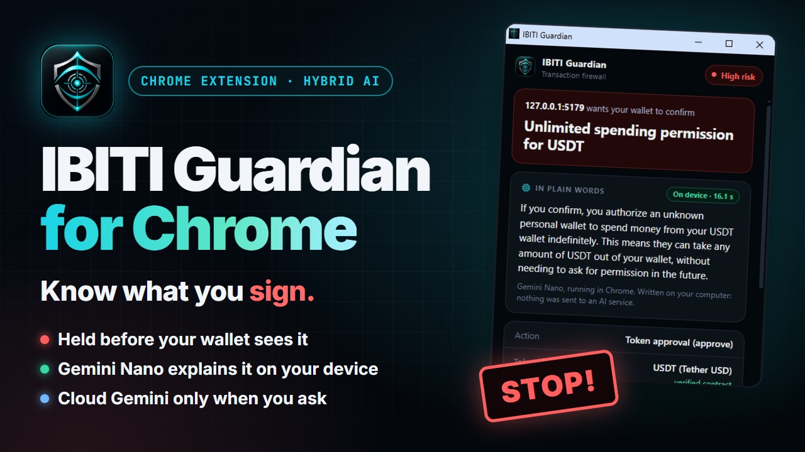
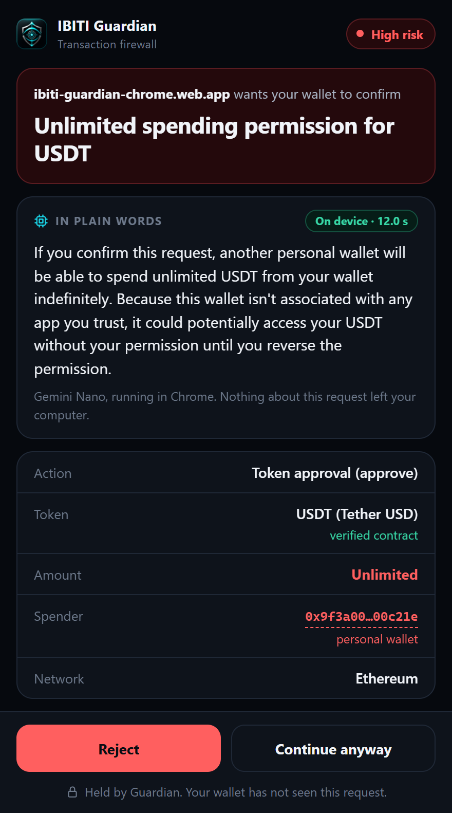
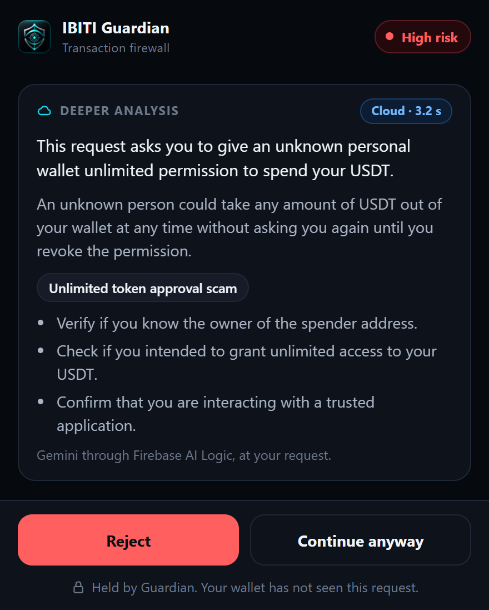
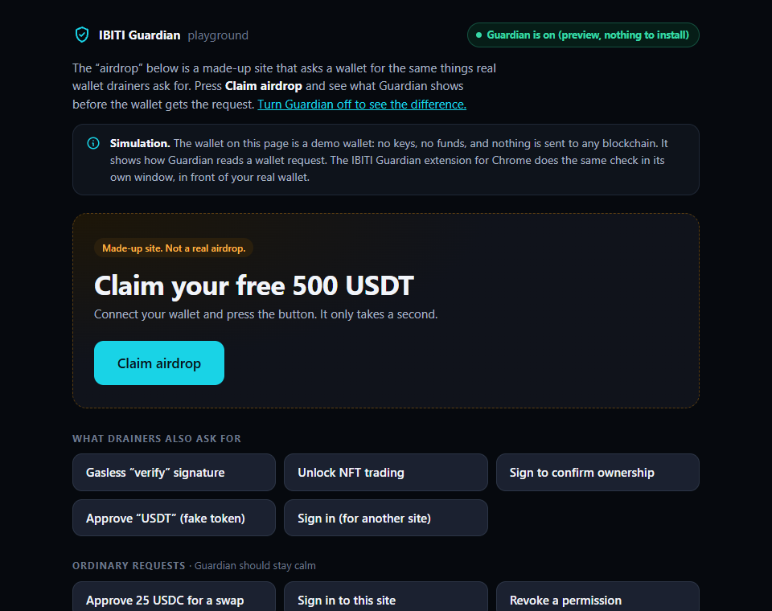
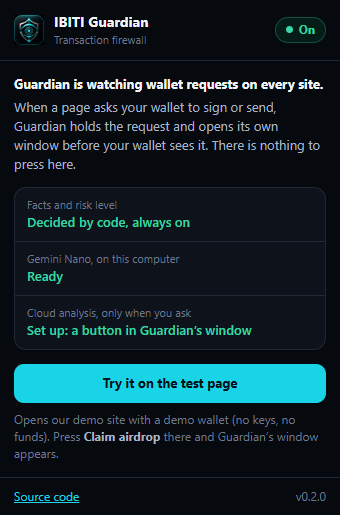

# IBITI Guardian for Chrome

**Know what you sign.** Wallet drainers rarely hack anything: they ask you to
sign. Guardian holds a wallet request *before your wallet sees it*, decodes it
into plain facts, lets Gemini explain it — on your device first, in the cloud
only when you ask — and then you decide.

**Try it now, nothing to install: https://ibiti-guardian-chrome.web.app**
(a simulation with a demo wallet that has no keys and no funds; the extension
does the same check in front of your real wallet).

**Video (2:54):** https://youtu.be/1xGWgzLbLEM · **Devpost:** https://devpost.com/software/ibiti-guardian-for-chrome-know-what-you-sign

<a href="https://youtu.be/1xGWgzLbLEM"></a>

<p>
  
  &nbsp;
  
</p>

Built for #BuildHybridAI 2026.

## What it does

1. **Holds the request.** When a page asks the wallet to sign or send
   (`eth_sendTransaction`, `eth_signTypedData_v4`, `personal_sign`, `eth_sign`,
   `wallet_sendCalls`), Guardian holds it and opens its own window. The wallet
   has not seen the request yet.
2. **Facts first, from code.** A deterministic analyzer decodes it: what
   action, which token (and whether its contract is the real one on that
   network), how much, to whom, on which network, and why it matters. The risk
   level — *High risk*, *Check carefully*, *No red flags found* — is decided by
   code, never by a model.
3. **Gemini explains it, on your device.** Gemini Nano turns the facts into
   two plain sentences on your own computer. No AI service is contacted.
4. **A deeper look, only if you ask.** One button sends the decoded facts
   (never your own wallet address) to Gemini in the cloud for a structured
   second opinion.
5. **You decide.** *Reject* returns the standard error 4001 to the site and
   the wallet never sees the request. *Continue* forwards exactly the request
   that was reviewed.

It recognises unlimited approvals, gasless permit signatures (EIP-2612 and
Permit2), NFT `setApprovalForAll`, blind `eth_sign`, fake tokens that borrow a
famous symbol, sign-in messages for a different site, transfers measured
against your balance, marketplace orders and batched calls — and it stays calm
on ordinary requests.

## How the hybrid AI is used

Firebase AI Logic hybrid inference, with the path chosen by the user's consent
rather than by an automatic fallback:

| | On device | In the cloud |
|---|---|---|
| Model | Gemini Nano, built into Chrome | Gemini (`gemini-3.5-flash-lite`) |
| Mode | `InferenceMode.ONLY_ON_DEVICE`, streaming | `InferenceMode.ONLY_IN_CLOUD`, JSON schema |
| When | By itself, as soon as the window opens | Only after the user presses **Ask cloud AI** |
| Sent to an AI service | Nothing | The decoded facts; never the user's address |
| Protected by | — (no network call) | Firebase App Check |

- Each answer shows where it ran and how long it took (*On device · 12.0 s*,
  *Cloud · 3.8 s*).
- Prompts are built only from the analyzer's facts, plus one exact sentence,
  written by code, on who would be allowed to do what — small models tend to
  swap the roles in an approval (`src/ai/prompt.js`).
- The model explains; it never decides what the request is or how risky it is.
- No Gemini API key is in the extension. Firebase AI Logic is the gateway
  (`src/ai/engine.js`).
- If the on-device model is not available, the facts and the decision still
  work, and the cloud button is there. If it only needs downloading, the
  window offers a one-time download.

## Try it in two minutes

1. Open https://ibiti-guardian-chrome.web.app and press **Claim airdrop**.
   The request is held; read the facts; press **Reject** or **Continue**. The
   log at the bottom says whether the demo wallet ever saw it.
2. Press the other buttons: five things drainers ask for, and four ordinary
   requests that Guardian should not make a fuss about.
3. Press **Turn Guardian off to see the difference** and click again: the
   same request goes straight to the wallet.

On-device explanations need a Chrome that has Gemini Nano (built-in AI). The
facts, the decision and the cloud analysis do not depend on it.



## Build the extension

```bash
npm install
cp src/config.example.js src/config.js   # then fill in your Firebase web config
npm run build        # dist/extension (the extension) and dist/site (the hosted demo)
```

Load `dist/extension` in `chrome://extensions` (Developer mode → Load
unpacked). Requires Chrome 139 or newer.

Guardian needs no clicks: it opens its own window when a page asks the wallet
to sign or send. The toolbar icon opens a small panel that says Guardian is on,
whether Gemini Nano and the cloud analysis are available in this build, and
opens the test page.



`src/config.js` is not in the repository. It needs a Firebase project with AI
Logic (Gemini Developer API) enabled; the cloud analysis in the extension also
needs an App Check debug token registered for that project (extension pages
cannot run reCAPTCHA). The example file says where to find both. Without it
the build still works, and so do the interception and the analyzer; only the
AI explanations need Firebase.

```bash
npm run demo         # local demo site at http://127.0.0.1:5179/demo/index.html
```

The local page uses the keyless demo wallet by default. With
`?wallet=real` it talks to an installed wallet instead, and only while that
wallet is on a test network.

## The hosted demo

`dist/site` is the demo site with a preview of Guardian built in. When the
extension is not installed, the page loads the very same in-page guard
(`src/inpage.js`) and shows the very same review window in a panel inside the
page. It is a preview, not protection: a panel inside a page can be removed by
that page, which is why the extension opens its own window instead.

The published site only ever uses the demo wallet and says so. It proves
itself to App Check with reCAPTCHA Enterprise; the App Check debug token is
never written into the site, and the build fails if it finds it there.

```bash
npm run deploy:site                                       # build, test, publish
SITE_URL=https://ibiti-guardian-chrome.web.app node test/site.mjs           # check the live site
SITE_URL=https://ibiti-guardian-chrome.web.app PHONE=1 node test/site.mjs   # on a phone screen
node test/cloud-live.mjs                                  # live cloud analysis via App Check
```

## Tests

```bash
npm test             # analyzer: decoding and risk rules
npm run test:e2e     # real Chrome: the extension, then the no-install site
```

The end-to-end tests check that a held request does not reach the wallet,
that Reject returns error 4001, that Continue forwards the request byte for
byte, that closing the window or losing contact with the extension refuses
the request, and that nothing is sent to the cloud before the user asks.
They also check the unfriendly cases: a wallet that replaces its own
`request()` after start-up stays guarded (`test/swap.mjs`), and a page cannot
change a request while it is being reviewed, hide the method behind a getter,
or slip a transaction through in a batch (`test/tamper.mjs`). `test/site.mjs`
runs all ten scenarios on the hosted demo, on desktop and phone screens.

By hand, with a real browser wallet on test networks: Reject kept the request
from the wallet; Continue delivered the same request to it.

## How it works

- `src/inpage.js` runs in the page before any site script and wraps wallet
  providers (`window.ethereum`, EIP-6963). Guarded methods are accessors, so a
  wallet that replaces its own `request()` later stays guarded. Guardian
  reviews and forwards its own copy of the request.
- `src/bridge.js` and `src/background.js` carry the request to Guardian's own
  window, which the site cannot touch. If that window is closed or the
  extension cannot be reached, the request is refused, never passed.
- `src/analyzer/` decodes the request without AI.
- `src/review.js` is the review window; `src/host.js` lets the same window run
  in the extension and in the hosted preview (`src/web/panel.js`).
- `src/ai/` is the hybrid inference: `engine.js` (the two paths),
  `prompt.js` (prompts from facts only), `appcheck.*.js` (App Check per build).

## Privacy

On-device by default. The cloud is contacted only after an explicit click, and
receives the decoded facts of the request — the site, the action, the token,
the amount, the other party's address — never the user's own address.
Guardian has no server of its own and keeps no history.

To describe a request, Guardian reads public context through your wallet's
own connection, the way the wallet itself would: whether the other party is a
contract, the token's symbol and decimals, and your balance of what is being
moved.

## Limits

Guardian wraps the standard provider API. A site that talks to a wallet
through a private channel instead is not covered, and the wallet's own
confirmation remains the last line of defense.

## License

Apache-2.0
