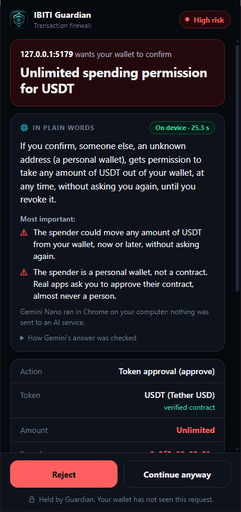
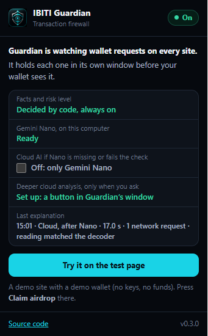

# IBITI Guardian for Chrome

**Know what you sign.** Wallet drainers rarely hack anything: they ask you to
sign. Guardian holds a wallet request *before your wallet sees it*, decodes it
into plain facts, lets Gemini explain it — on your device first, in the cloud
only if you allow it — and then you decide.

**Try it now, nothing to install: https://ibiti-guardian-chrome.web.app**
(a simulation with a demo wallet that has no keys and no funds; the extension
does the same check in front of your real wallet).

**Video (2:54):** https://youtu.be/1xGWgzLbLEM · **Devpost:** https://devpost.com/software/ibiti-guardian-for-chrome-know-what-you-sign

<a href="https://youtu.be/1xGWgzLbLEM"></a>

<p>
  
  &nbsp;
  
</p>

Built for #BuildHybridAI 2026.

## What it does

1. **Holds the request.** When a page asks the wallet to sign or send
   (`eth_sendTransaction`, `eth_signTypedData_v4`, `personal_sign`, `eth_sign`,
   `wallet_sendCalls`), Guardian holds it and opens its own window. The wallet
   has not seen the request yet.
2. **Facts first, from code.** A deterministic analyzer decodes it: what
   action, which token (and whether its contract is the real one on that
   network), how much, to whom, on which network, and why it matters. The risk
   level — *High risk*, *Check carefully*, *No red flags found* — is decided by
   code, never by a model.
3. **Gemini reads it too, on your device.** The sentence on what confirming
   does and the warnings are written by code. Gemini Nano reads the decoded
   request on your own computer and answers a short form; code checks its
   reading against the decoder and only then lets it pick the reasons that
   matter most. No AI service is contacted. On a computer without Gemini
   Nano, a one-time permission lets Gemini in the cloud do it instead
   (Firebase AI Logic's hybrid fallback).
4. **A deeper look, only if you ask.** One button sends the decoded facts,
   with the words of the button you pressed, the page title and the nearest
   heading (never your own wallet address), to Gemini in the cloud for a
   structured second opinion: the scam pattern it matches and what to verify, picked
   from fixed lists that code checks against the request.
5. **You decide.** *Reject* returns the standard error 4001 to the site and
   the wallet never sees the request. *Continue* forwards exactly the request
   that was reviewed.

It recognises unlimited approvals, gasless permit signatures (EIP-2612 and
Permit2), NFT `setApprovalForAll`, blind `eth_sign`, fake tokens that borrow a
famous symbol, sign-in messages for a different site, transfers measured
against your balance, marketplace orders and batched calls — and it stays calm
on ordinary requests.

## What the button said, and what the request does

Drainers rarely ask in so many words: the button says *Claim airdrop* or
*Check eligibility*, and the request it sends gives someone the right to take
your tokens. Guardian keeps the words of the button you pressed just before
the request (a real click only; a click the page makes itself does not
count, and any later click replaces it), with the page's title and the
nearest heading above the button, and compares what they offer with what the
request does (`src/analyzer/promise.js`). Addresses in these words, whole or
shortened, are taken out before anything is cut short, shown or sent.

- **Code reads plain words** — claim, reward, eligibility, sign in, verify,
  revoke, mint, swap, pay, stake, approve. The window opens on the
  comparison: *The button said “Claim airdrop”*, then *Does not match*, then
  what the request really does. Only a clear contradiction is a warning: a button that
  offers to receive something, to sign in or to remove a permission, on a
  request that takes assets out or grants a permission (a sign-in or a revoke
  also on coins sent to a contract call Guardian cannot read); or a mint,
  swap, payment or stake that asks for every item in a collection. A button
  that names more than one thing counts only if all of them contradict the
  request: *Approve and claim* says it approves, so on a permission it is no
  warning. Only verbs approve: *approve* and *authorize* anywhere; *unlock*,
  *enable*, *allow*, *list*, *sell*, *grant* and *permit* only at the start
  of the button or of a clause (*Claim and sell*). Nouns never do: *Connect
  wallet to check approvals* offers a sign-in, *Revoke approval* offers to
  revoke, and *Claim grant* offers to receive. Where code is not sure, it says
  nothing and leaves the words to Gemini: *Unlock rewards* on a payment (it
  may be paying to unlock something), or *Redeem*, *Collect* or *Enter to win*
  on a token permission (redeeming shares or a paid entry can rightly need
  one); *Collect* on a marketplace order for the user's own items stays a
  warning, since no purchase needs one. A contradiction read by code makes
  the request *High risk*. *No mismatch found* is said only by code, and only
  on a request with no red flags.
- **Gemini reads the words code cannot** — *Continue*, *Получить бонус*,
  *立即领取* — judging by the button's words, the page title and the heading,
  not by the request. Its reading is used only when its whole form passed the
  check, only to add a warning (in code's words, marked ✦ and *read by
  Gemini*), never to change the risk level and never to say there is no
  mismatch.

Measured on 2026-11-17 with Gemini Nano in Chrome, on a small sample of 8
unclear buttons in English, Russian and Chinese: 6 of 8 read exactly as meant
(it took *Check eligibility* for a sign-in and *Join waitlist* for a mint);
the warning decision was right on 8 of 8, with no false warning. Asked the
same thing as part of a form that put the request first, it had read 2 of 7.

On the demo page, **Write the button yourself** lets you type the button's
words and choose what it really asks for: a hidden permission to take USDT,
or a plain sign-in where nothing moves.

## How the hybrid AI is used

Firebase AI Logic hybrid inference. Gemini reads every request Guardian can
decode, on the computer whenever Gemini Nano is there. Once the user has
allowed the cloud, the SDK falls back to Gemini in the cloud on computers
without it, and when Gemini Nano's answer does not pass Guardian's check,
Gemini in the cloud reads the request once more. The answer is always a form,
never text for the user.

| | Gemini's reading | Gemini's reading, cloud allowed | Deeper analysis |
|---|---|---|---|
| Mode | `ONLY_ON_DEVICE` | `PREFER_ON_DEVICE`; then `ONLY_IN_CLOUD` once if Nano's answer fails the check | `ONLY_IN_CLOUD` |
| Answer | A JSON form (Prompt API `responseConstraint`) | The same form (`responseConstraint` on device, `responseJsonSchema` in the cloud) | A JSON form (`responseJsonSchema`) |
| Model | Gemini Nano, built into Chrome | Gemini Nano if ready, else `gemini-3.5-flash-lite` | `gemini-3.5-flash-lite` |
| When | By itself (the default) | By itself, after a one-time **Allow cloud AI as a fallback** | Only after the user presses **Ask cloud AI** |
| Sent to an AI service | Nothing | Nothing when Nano's answer passes; otherwise the decoded facts and the page's words (button, title, heading) | The decoded facts and the page's words |
| Protected by | — (no network call) | Firebase App Check | Firebase App Check |

**Who writes what.** Every word in Guardian's window is written by code.
Gemini never writes text the user reads: it answers a form, and code checks
the form against the decoded request before using any of it.

- **Code** (`src/analyzer/`, `src/ai/prompt.js`) writes the facts, the risk
  level, one sentence on what confirming does — for example *If you confirm,
  an unknown personal wallet can take any amount of USDT from your wallet,
  whenever it wants, without asking you, until you revoke it.* — and the
  **warnings**: the reasons that alone
  make a request high risk (a personal wallet as the spender, an unlimited
  permission for an unknown address, a token that borrows a famous name, coins
  attached to a token call, a sign-in for a different site, almost the whole
  balance). They are on screen at once, with or without AI, and no AI can
  remove them.
- **Gemini** reads the decoded facts — not the code's sentence, so its reading
  is a second one — and answers a form (`src/ai/reading.js`): what kind of
  request it is, who would gain, which way the user's assets would move,
  whether it is unlimited, and which of the analyzer's reasons matter most.
- **Code compares the form with the decoded request.** If any field differs
  — "you" gain where someone else does, assets "come in" where they go out,
  "limited" where it is unlimited — none of the answer is used. If all fields
  match, the reasons Gemini picked are added after the warnings (marked ✦),
  in the analyzer's own words. The main view never says that Gemini "agrees"
  (that could read as an all-clear); how its answer was checked is under
  **How Gemini's answer was checked**.
- **The deeper analysis** answers the same reading, plus a scam pattern and
  the things to check, each picked from a fixed list written in code. A known
  pattern needs evidence the analyzer found: an approval, a permit or a batch
  is no scam by itself, so a pattern is accepted only on a request Guardian
  rates high risk, with its warnings, and only one that request has the shape
  of ("permit phishing" only on a permit signature). Marketplace orders are
  not on the list: Guardian cannot see an order's price. The label says *Has
  the shape of …*, and under it: *A pattern is not proof of a scam*. On a
  high-risk request with a fitting pattern, "no known pattern" is not
  accepted. Code adds the checks that must always be shown (marked ⚠).

Measured on 2026-11-17 on the demo's requests: Gemini in the cloud read 27
of 27 the way the decoder did (and 25 of 25 deeper analyses fit); Gemini Nano
in Chrome read 6 of 9 (it took a collection approval for several actions,
and a revoke and a sign-in for another site as something that takes assets).
When a reading differs, nothing from it is used and Guardian's own text and
warnings stand alone; with the user's permission, Gemini in the cloud then
reads the request once more, and its answer is checked the same way.

While Gemini reads, the window counts the seconds and says the user can
decide without it: the facts, the warnings and both buttons are there from
the start. Gemini Nano usually answers in 15–30 seconds; it has twice not
answered at all, so after 90 seconds Guardian stops waiting, says *no answer
in 90 s*, and treats it like an answer that did not pass.

What this does and does not prove: Gemini cannot put an amount, an address,
a token, a role or a direction on screen that the decoder did not find, and
it cannot hide a warning. It does not prove the rest of Guardian is free of
mistakes: the analyzer and the build are tested on their own (`npm test`,
`npm run test:e2e`), and the analyzer's decoding is what the window stands on.

- The permission is off until the user turns it on, in Guardian's window or
  its toolbar panel (where it can be turned off again). It says what it
  covers: no on-device model, or Gemini Nano's answer not passing the check.
  Without it nothing goes to the cloud; after a failed Nano answer the window
  offers it, and only the cloud is asked then. The hosted demo keeps it for
  the visit only.
- **Exactly what would be sent** shows the full text next to the one-time
  permission, and **Exactly what was sent** after every cloud answer. It
  never holds the user's wallet address or balance; for a payment measured
  against the balance, the risk level stays on the computer too.
- Each answer shows where it ran and how long it took (*On device · 3.0 s*,
  *Cloud fallback · 1.6 s*, *Cloud · 2.3 s*), from the SDK's
  `inferenceSource`.
- The SDK falls back when no on-device model is ready (including one that
  still needs downloading; the window then also offers the download). If
  Gemini Nano is there but fails while answering, Guardian's own text stands
  alone that time; the facts and the decision never depend on it.
- **No guessing.** A request the analyzer cannot decode (a blind signature,
  an unknown contract call or data format, a batch with such a call) gets no
  AI at all: a model could only guess.
- Text a website writes itself (an app name, a sign-in domain) goes into
  prompts quoted and short, as data; an unverified token's symbol is kept
  only if it is a plain ticker.
- No Gemini API key is in the extension. Firebase AI Logic is the gateway
  (`src/ai/engine.js`).
- If no AI answers at all (no on-device model and no permission for the
  cloud), the facts, the code's sentence and the decision still work.

## Try it in two minutes

1. Open https://ibiti-guardian-chrome.web.app and press **Claim airdrop**.
   The request is held. The window opens on what the button said against
   what the request really does (*Does not match*); press **Reject** or
   **Continue**. The strip at the top of the page shows where the request
   went: stopped at Guardian, or through to the demo wallet.
2. Press **Approve 25 USDC for a swap** next to it: an ordinary request, and
   Guardian stays calm. More examples are below: five other things drainers
   ask for, and three ordinary requests.
3. In **Write the button yourself**, type any words for the button (try
   *Continue* or *Approve and claim*) and choose what it really asks for: see
   when Guardian says the button and the request do not match, and when
   Gemini reads words code cannot (marked ✦).
4. Press **Turn Guardian off to see the difference** and click again: the
   same request goes straight to the wallet.

Gemini's on-device reading needs a Chrome that has Gemini Nano (built-in
AI). Without it, press **Allow cloud AI as a fallback** once, and Gemini in
the cloud reads the requests instead for the rest of the visit. The facts, the
decision and the deeper analysis do not depend on either.


## Build the extension

```bash
npm install
cp src/config.example.js src/config.js   # then fill in your Firebase web config
npm run build        # dist/extension (the extension) and dist/site (the hosted demo)
```

Load `dist/extension` in `chrome://extensions` (Developer mode → Load
unpacked). Requires Chrome 139 or newer.

Guardian needs no clicks: it opens its own window when a page asks the wallet
to sign or send. The toolbar icon opens a small panel that says Guardian is on,
whether Gemini Nano and the cloud analysis are available in this build, holds
the switch for the cloud fallback (off until you turn it on, here or in
Guardian's window), and opens the test page.



`src/config.js` is not in the repository. It needs a Firebase project with AI
Logic (Gemini Developer API) enabled; the cloud analysis in the extension also
needs an App Check debug token registered for that project (extension pages
cannot run reCAPTCHA). The example file says where to find both. Without it
the build still works, and so do the interception and the analyzer; only the
AI explanations need Firebase.

```bash
npm run demo         # local demo site at http://127.0.0.1:5179/demo/index.html
```

The local page uses the keyless demo wallet by default. With
`?wallet=real` it talks to an installed wallet instead, and only while that
wallet is on a test network.

## The hosted demo

`dist/site` is the demo site with a preview of Guardian built in. When the
extension is not installed, the page loads the very same in-page guard
(`src/inpage.js`) and shows the very same review window in a panel inside the
page. It is a preview, not protection: a panel inside a page can be removed by
that page, which is why the extension opens its own window instead.

The published site only ever uses the demo wallet and says so. It proves
itself to App Check with reCAPTCHA Enterprise; the App Check debug token is
never written into the site, and the build fails if it finds it there.

```bash
npm run deploy:site                                       # build, test, publish
SITE_URL=https://ibiti-guardian-chrome.web.app node test/site.mjs           # check the live site
SITE_URL=https://ibiti-guardian-chrome.web.app PHONE=1 node test/site.mjs   # on a phone screen
node test/cloud-live.mjs                                  # live cloud analysis via App Check
```

## Tests

```bash
npm test             # analyzer: decoding and risk rules; what prompts may send to the cloud
npm run test:e2e     # real Chrome: the extension, then the no-install site
```

`npm test` also checks Gemini's part (`test/reading.test.js`): every wrong
value of every field is caught for every kind of request; every high-risk
request carries a warning that stays on screen whatever the model picks; real
Gemini answers recorded live (`test/fixtures/real-forms.json`) get the
verdict they deserve; and two blind sets of right and wrong answers, written
by an author who never saw the checks, stay caught
(`test/fixtures/forms-set-*.json`).

The end-to-end tests check that a held request does not reach the wallet,
that Reject returns error 4001, that Continue forwards the request byte for
byte, that closing the window or losing contact with the extension refuses
the request, and that nothing is sent to the cloud before the user asks.
With a stand-in for Gemini Nano they check what the window shows for a right
reading, a reading that picks no warning, a swapped role, a swapped
direction, an answer with words of its own, and an answer that is not the
form: the warnings always stay, a wrong reading is never used, and no word
of the model reaches the screen.
They also check the unfriendly cases: a wallet that replaces its own
`request()` after start-up stays guarded (`test/swap.mjs`), and a page cannot
change a request while it is being reviewed, hide the method behind a getter,
or slip a transaction through in a batch (`test/tamper.mjs`). `test/site.mjs`
runs all ten scenarios on the hosted demo, on desktop and phone screens.

By hand, with a real browser wallet on test networks: Reject kept the request
from the wallet; Continue delivered the same request to it.

## How it works

- `src/inpage.js` runs in the page before any site script and wraps wallet
  providers (`window.ethereum`, EIP-6963). Guarded methods are accessors, so a
  wallet that replaces its own `request()` later stays guarded. Guardian
  reviews and forwards its own copy of the request.
- `src/bridge.js` and `src/background.js` carry the request to Guardian's own
  window, which the site cannot touch. If that window is closed or the
  extension cannot be reached, the request is refused, never passed.
- `src/analyzer/` decodes the request without AI.
- `src/review.js` is the review window; `src/host.js` lets the same window run
  in the extension and in the hosted preview (`src/web/panel.js`).
- `src/ai/` is the hybrid inference: `engine.js` (the three modes),
  `prompt.js` (prompts from facts only), `appcheck.*.js` (App Check per build).

## Privacy

On-device by default. The cloud is contacted only after an explicit choice:
the one-time permission for computers without Gemini Nano (switched off again
in the toolbar panel; on the hosted demo it lasts for the visit), or the
**Ask cloud AI** button. It receives the decoded facts of the request — the
site, the action, the token, the amount, the other party's address — and the
words of the button the user pressed, with the page's title and the nearest
heading. Those are the site's own words and can hold personal details (a
page may greet the user by name); the permission and the button say so, and
**Exactly what would be sent** shows them. Never the user's own address or
balance, no form fields, no other page text. Guardian has no server of its
own and keeps no history.

To describe a request, Guardian reads public context through your wallet's
own connection, the way the wallet itself would: whether the other party is a
contract, the token's symbol and decimals, and your balance of what is being
moved.

## Limits

Guardian wraps the standard provider API. A site that talks to a wallet
through a private channel instead is not covered, and the wallet's own
confirmation remains the last line of defense.

## License

Apache-2.0
